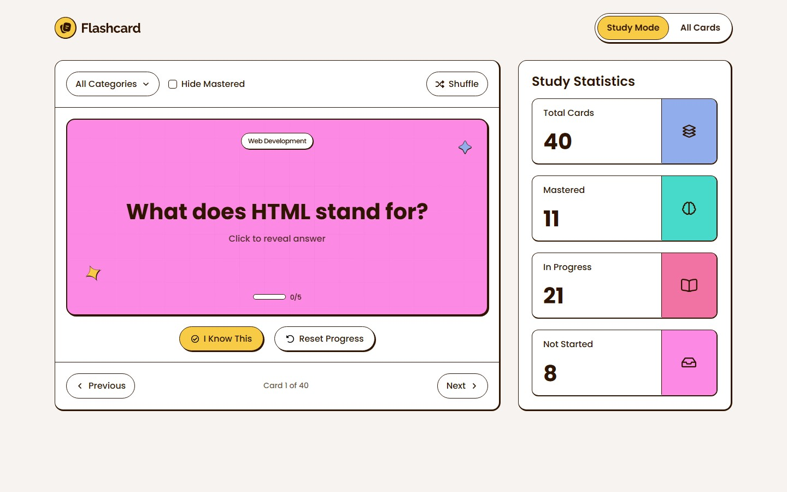

# Frontend Mentor - Flashcard app solution

This is a solution to the [Flashcard app challenge on Frontend Mentor](https://www.frontendmentor.io/challenges/flashcard-app). It is a browser-based app for creating flashcards and tracking study progress.

## Table of contents

- [Overview](#overview)
  - [Features](#features)
  - [Screenshot](#screenshot)
  - [Links](#links)
- [My process](#my-process)
  - [Built with](#built-with)
  - [What I learned](#what-i-learned)
  - [AI collaboration](#ai-collaboration)
- [Running locally](#running-locally)

## Overview

### Features

- Create, edit, and delete cards with a question, answer, and category; required fields show validation messages.
- Study one card at a time, flip it to reveal the answer, move between cards, and track mastery from 0 to 5. Progress can be reset per card.
- Filter by multiple categories, hide mastered cards, and shuffle the current set. Category options show their card counts.
- Switch between Study Mode and All Cards. The card grid reveals more cards in batches of 12.
- See totals for mastered, in-progress, and not-started cards, plus toast feedback after card changes.
- Keep card changes across browser sessions with `localStorage`. Without saved data, the app loads 40 starter cards from `src/data.json`. If browser storage is unavailable, changes remain available only for the current session.
- Use the keyboard to flip cards and operate dialogs. Dynamic updates are announced to screen readers, focus returns after dialogs and card actions, and reduced-motion settings disable supported animations.

### Screenshot



### Links

- [Source code](https://github.com/jonghwascript/flashcard-app)

## My process

### Built with

- Semantic HTML and HTML partials
- SCSS, CSS Grid, Flexbox, and Poppins from Google Fonts
- Vanilla JavaScript and browser `localStorage`
- Gulp for HTML assembly, SCSS compilation, and static asset copying

### What I learned

The Study and All Cards views use separate filter state so that switching views preserves each view's position and selections. Card changes go through one update path that saves data and refreshes the UI. The app also restores focus after dialogs and card actions and announces dynamic updates through a live region.

### AI collaboration

I used AI to generate the initial HTML and CSS, then reviewed and refined the implementation with a focus on semantic HTML, accessibility, and responsive layout.
I also tested the result across different screen sizes and made adjustments to improve the code's flexibility and maintainability.
This challenge helped me practice reviewing AI-generated code and making more informed frontend development decisions.

## Running locally

Install dependencies with `npm install`. The project source is in `src/`, and the generated site is served from `dist/`.

The Gulp `build` and `dev` tasks delete and recreate `dist/` before generating files. If you need to preserve files in `dist/`, inspect and back them up before running either task.

```sh
npm run build
npm run dev
```

`npm run dev` starts BrowserSync on port 3000. The `npm test` script is currently a placeholder and does not run a test suite. See the [layout verification guide](./tests/layout/README.md) for the available checks and their requirements.
